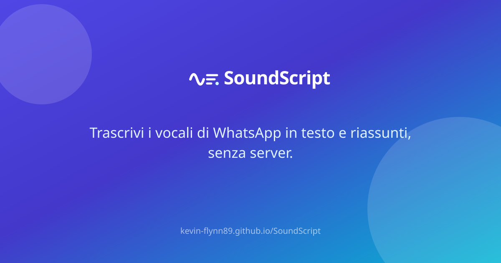
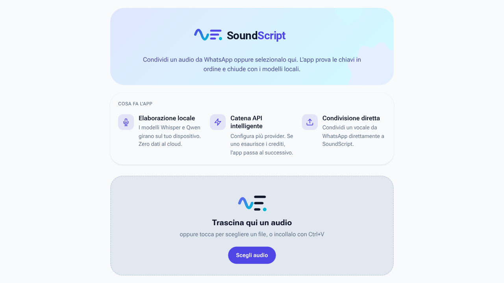
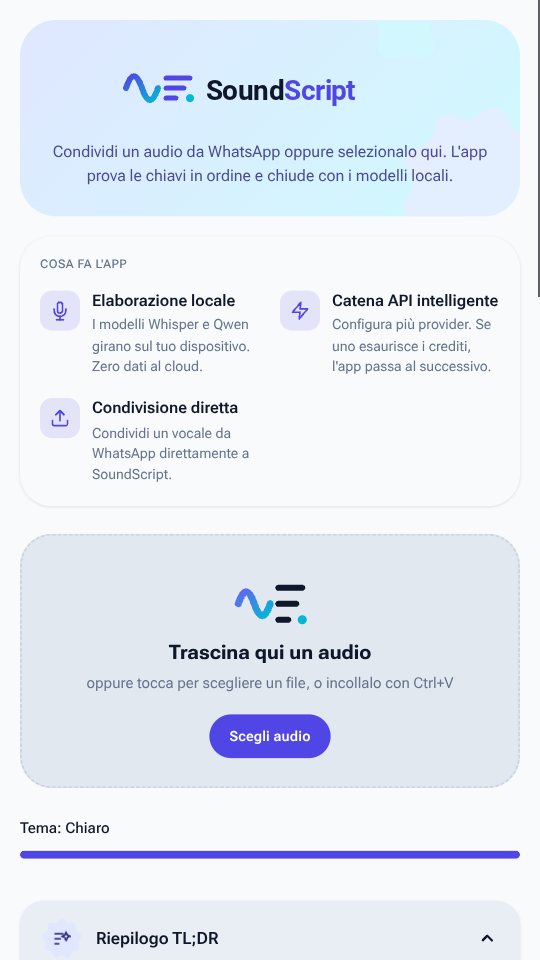

# 🎙️ SoundScript

**Turn voice notes into text and summaries — entirely in your browser.**
**Trasforma i vocali in testo e riassunti — interamente nel tuo browser.**

[**🇬🇧 English**](#english) · [**🇮🇹 Italiano**](#italiano)

[Live app](https://kevin-flynn89.github.io/SoundScript/) · [Releases](../../releases) · [Issues](../../issues)

  

---

## 🇬🇧 English

> [!TIP]
> **Try it now:** [kevin-flynn89.github.io/SoundScript](https://kevin-flynn89.github.io/SoundScript/) — no signup, no server, no data leaving your device except the API calls you configure yourself.

### What is SoundScript?

SoundScript is a **privacy-first Progressive Web App** that transcribes voice messages (e.g. from WhatsApp) and produces tailored TL;DR summaries. It runs on a **smart provider chain**: your API keys are tried in order with retries and model fallbacks, and if everything fails — or you're offline — **on-device models** (Whisper + Qwen via Transformers.js) take over.

### Screenshots

| Desktop | Mobile |
|:---:|:---:|
|  |  |

### Features

- 🎙️ **Transcription chain** — OpenAI, Groq, Google Gemini, Mistral, custom OpenAI-compatible endpoints; Anthropic for summaries. Automatic retries, suggested-model fallback, per-key error memory.
- 🧠 **On-device fallback** — Whisper (tiny/base) + Qwen2.5 run locally via WebGPU/WASM; fully offline once downloaded.
- 📝 **Custom TL;DR** — length, style (narrative / bullets / actions & deadlines / formal / friendly), language, custom instructions, saved presets; auto-generated for audio over 60 s.
- ▶️ **Built-in audio player** — play/pause, ±10 s, draggable seek, playback speed 0.75×–2×.
- 🗂️ **History** — auto-saved (last 20), full-text & date search, per-entry delete, clear-all, JSON export.
- 📤 **Export** — TXT, Markdown, and PDF (via a branded print sheet).
- 📲 **Share target** — share audio straight from WhatsApp on Android & desktop; on iOS use the Files workaround (see in-app FAQ).
- 📱 **Full PWA** — installable with icons, screenshots and home-screen shortcuts ("New transcription", "History"), offline support, silent background updates.
- 🛟 **QoL** — draft recovery after accidental reloads, paste-audio-from-clipboard, cancel button, API-key tester, manual theme (auto/light/dark), end-of-processing vibration/notifications, status badges.
- ♿ **Accessible** — visible focus rings, screen-reader live announcements, AA contrast, reduced-motion support.

### How it works

1. **Input** — drop a file, pick one, paste from clipboard, or share from WhatsApp.
2. **Transcribe** — providers are tried in your chain order; local models close the chain.
3. **Summarize** — TL;DR generated with your rules (auto for audio > 60 s).
4. **Use** — listen with the player, edit, copy, export, or find it later in History.

### Supported providers

| Provider | Transcription | Summary | Notes |
|---|:---:|:---:|---|
| OpenAI | ✅ | ✅ | |
| Groq | ✅ | ✅ | fast free tier |
| Google Gemini | ✅ | ✅ | audio inline |
| Mistral | ✅ | ✅ | Voxtral STT |
| Anthropic | ❌ | ✅ | chat-only: transcription skips to next in chain |
| Custom endpoint | ✅ | ✅ | any OpenAI-compatible URL |
| **Local (offline)** | ✅ | ✅ | Whisper + Qwen, WebGPU/WASM |

### Privacy & data

- **No backend, no database, no analytics.** The site is static GitHub Pages.
- API keys, settings and history live **only in your browser** (localStorage/sessionStorage).
- Audio files are kept **in memory for the current session only** (player); they are never stored in history.
- Exports and printing happen **entirely client-side**.

### Install as an app

- **Android / Desktop Chrome-Edge:** install prompt with screenshots; long-press the icon for shortcuts.
- **iOS / iPadOS:** Safari → Share → *Add to Home Screen*.

> [!NOTE]
> iOS does not allow web apps in WhatsApp's share sheet (system limitation). Workaround: in WhatsApp long-press the audio → Share → **Save to Files**, then open SoundScript → **Choose audio**.

### For developers

**Stack:** Vite · vanilla ES modules · [@huggingface/transformers](https://github.com/huggingface/transformers.js) · hand-rolled service worker.

    SoundScript/
    ├─ .github/workflows/deploy.yml   # Pages deploy + PNG asset generation (rsvg-convert)
    ├─ index.html                     # meta OG/Twitter, self-hosted font preload
    ├─ public/
    │  ├─ manifest.json               # icons, shortcuts, screenshots, share_target
    │  ├─ sw.js                       # offline cache, share-target POST handler
    │  ├─ share-target.html
    │  ├─ fonts/roboto-flex.woff2     # self-hosted variable font
    │  ├─ screenshots/                # real store screenshots (replace placeholders)
    │  └─ *.svg                       # icons, logos, OG banner, placeholders
    └─ src/
       ├─ main.js                     # UI, chain orchestration, player, history, exports
       ├─ providers.js                # API adapters (OpenAI/Groq/Google/Mistral/Anthropic)
       └─ style.css                   # design system, themes, print sheet

    npm install
    npm run dev      # local dev server
    npm run build    # outputs dist/

Deploy: push to `main` → GitHub Actions builds, rasterizes SVG assets (icons, OG banner, shortcut icons; screenshot placeholders only if real PNGs are missing) and publishes to Pages.

### Performance & quality highlights

- Core bundle ~24 KB gzip-critical path; the ML library is a **separate chunk loaded on demand**.
- Self-hosted variable font with `preload` + `font-display: optional` → **zero layout shift**.
- Service worker: network-first navigations, cache-first assets, silent self-update.
- Lighthouse-optimized: AA contrast, focus management, live regions, semantic markup.

### Troubleshooting

| Symptom | Cause / fix |
|---|---|
| `401/403` on a key | Key invalid or revoked — use the **Test** button before saving |
| `429` | Rate limit — the app retries once, then moves to the next provider |
| No WhatsApp share on iPhone | iOS limitation — use the Files workaround above |
| Local models slow first time | One-time download; use *Download local models now* on Wi-Fi |

### Credits & license

Built with [Transformers.js](https://huggingface.co/docs/transformers.js), [Roboto Flex](https://fonts.google.com/specimen/Roboto+Flex) and the public APIs of the providers listed above.
Personal project — all rights reserved unless a LICENSE file states otherwise.

---

## 🇮🇹 Italiano

> [!TIP]
> **Provala subito:** [kevin-flynn89.github.io/SoundScript](https://kevin-flynn89.github.io/SoundScript/) — niente registrazione, niente server, niente dati che lasciano il dispositivo tranne le chiamate API che configuri tu.

### Cos'è SoundScript?

SoundScript è una **Progressive Web App privacy-first** che trascrive i messaggi vocali (es. da WhatsApp) e genera riassunti TL;DR su misura. Funziona con una **catena intelligente di provider**: le tue chiavi API vengono provate in ordine con retry e fallback di modello; se tutto fallisce — o sei offline — subentrano i **modelli on-device** (Whisper + Qwen via Transformers.js).

### Catture schermo

| Desktop | Mobile |
|:---:|:---:|
|  |  |

### Funzionalità

- 🎙️ **Catena di trascrizione** — OpenAI, Groq, Google Gemini, Mistral, endpoint personalizzati compatibili OpenAI; Anthropic per i riassunti. Retry automatici, fallback sul modello suggerito, memoria degli errori per chiave.
- 🧠 **Fallback on-device** — Whisper (tiny/base) + Qwen2.5 girano in locale via WebGPU/WASM; offline completo dopo il primo download.
- 📝 **TL;DR su misura** — lunghezza, stile (narrativo / elenco / azioni e scadenze / formale / amichevole), lingua, istruzioni personalizzate, preset salvati; automatico sopra i 60 s.
- ▶️ **Player integrato** — play/pausa, ±10 s, seek trascinabile, velocità 0,75×–2×.
- 🗂️ **Cronologia** — salvataggio automatico (ultime 20 voci), ricerca su testo e data, eliminazione singola, svuotamento, export JSON.
- 📤 **Export** — TXT, Markdown e PDF (foglio di stampa brandizzato).
- 📲 **Share target** — condividi l'audio da WhatsApp su Android e desktop; su iOS c'è il percorso Files (vedi FAQ in app).
- 📱 **PWA completa** — installabile con icone, screenshot e scorciatoie home ("Nuova trascrizione", "Cronologia"), offline, aggiornamenti silenziosi.
- 🛟 **Qualità della vita** — recupero bozza dopo reload accidentale, incolla audio dagli appunti, pulsante Annulla, test chiave API, tema manuale (auto/chiaro/scuro), vibrazione/notifiche a fine elaborazione, badge di stato.
- ♿ **Accessibile** — focus ring visibili, annunci per screen reader, contrasto AA, rispetto di reduced-motion.

### Come funziona

1. **Ingresso** — trascina un file, sceglilo, incollalo dagli appunti o condividilo da WhatsApp.
2. **Trascrizione** — i provider vengono provati nell'ordine della tua catena; i modelli locali la chiudono.
3. **Riepilogo** — TL;DR generato con le tue regole (automatico sopra i 60 s).
4. **Uso** — riascolta col player, modifica, copia, esporta o ritrova tutto in Cronologia.

### Provider supportati

| Provider | Trascrizione | Riepilogo | Note |
|---|:---:|:---:|---|
| OpenAI | ✅ | ✅ | |
| Groq | ✅ | ✅ | piano gratuito veloce |
| Google Gemini | ✅ | ✅ | audio inline |
| Mistral | ✅ | ✅ | STT Voxtral |
| Anthropic | ❌ | ✅ | solo chat: la trascrizione passa al provider successivo |
| Endpoint custom | ✅ | ✅ | qualsiasi URL compatibile OpenAI |
| **Locale (offline)** | ✅ | ✅ | Whisper + Qwen, WebGPU/WASM |

### Privacy e dati

- **Nessun backend, nessun database, nessuna analytics.** Il sito è GitHub Pages statico.
- Chiavi API, impostazioni e cronologia vivono **solo nel tuo browser** (localStorage/sessionStorage).
- I file audio restano **in memoria per la sola sessione corrente** (player); non finiscono mai nella cronologia.
- Export e stampa avvengono **interamente lato client**.

### Installa come app

- **Android / Desktop Chrome-Edge:** prompt di installazione con screenshot; pressione lunga sull'icona per le scorciatoie.
- **iOS / iPadOS:** Safari → Condividi → *Aggiungi a Home*.

> [!NOTE]
> iOS non consente alle web app di comparire nel menu Condividi di WhatsApp (limite di sistema). Alternativa: in WhatsApp tieni premuto l'audio → Condividi → **Salva su File**, poi apri SoundScript → **Scegli audio**.

### Per sviluppatori

**Stack:** Vite · vanilla ES modules · [@huggingface/transformers](https://github.com/huggingface/transformers.js) · service worker artigianale.

    SoundScript/
    ├─ .github/workflows/deploy.yml   # deploy Pages + generazione PNG (rsvg-convert)
    ├─ index.html                     # meta OG/Twitter, preload font self-hosted
    ├─ public/
    │  ├─ manifest.json               # icone, scorciatoie, screenshot, share_target
    │  ├─ sw.js                       # cache offline, gestore POST share-target
    │  ├─ share-target.html
    │  ├─ fonts/roboto-flex.woff2     # font variabile self-hosted
    │  ├─ screenshots/                # screenshot reali (sostituiscono i segnaposto)
    │  └─ *.svg                       # icone, loghi, banner OG, segnaposto
    └─ src/
       ├─ main.js                     # UI, orchestrazione catena, player, cronologia, export
       ├─ providers.js                # adapter API (OpenAI/Groq/Google/Mistral/Anthropic)
       └─ style.css                   # design system, temi, foglio di stampa

    npm install
    npm run dev      # server di sviluppo locale
    npm run build    # genera dist/

Deploy: push su `main` → GitHub Actions compila, rasterizza gli asset SVG (icone, banner OG, icone scorciatoie; segnaposto screenshot solo se i PNG reali mancano) e pubblica su Pages.

### Punti di forza prestazionali

- Bundle core leggero: la libreria ML è un **chunk separato caricato on demand**.
- Font variabile self-hosted con `preload` + `font-display: optional` → **zero layout shift**.
- Service worker: navigazioni network-first, asset cache-first, auto-aggiornamento silenzioso.
- Ottimizzato Lighthouse: contrasto AA, gestione focus, live region, markup semantico.

### Risoluzione problemi

| Sintomo | Causa / soluzione |
|---|---|
| `401/403` su una chiave | Chiave non valida o revocata — usa il pulsante **Testa** prima di salvare |
| `429` | Limite di frequenza — l'app riprova una volta, poi passa al provider successivo |
| Niente condivisione WhatsApp su iPhone | Limite iOS — usa il percorso Files qui sopra |
| Modelli locali lenti la prima volta | Download una tantum; usa *Scarica modelli locali ora* sotto Wi-Fi |

### Crediti e licenza

Realizzato con [Transformers.js](https://huggingface.co/docs/transformers.js), [Roboto Flex](https://fonts.google.com/specimen/Roboto+Flex) e le API pubbliche dei provider elencati.
Progetto personale — tutti i diritti riservati, salvo diverso file LICENSE.

**[⬆ back to top / torna su](#top)**

